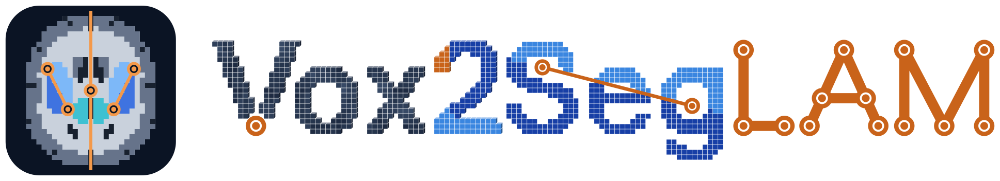
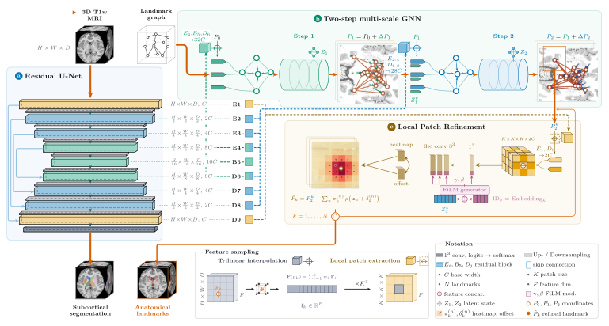

<p align="center">
  <picture>
    <source media="(prefers-color-scheme: dark)" srcset="assets/logo/vox2seglam-lockup-dark.svg">
    
  </picture>
</p>

<p align="center">
  One network for subcortical <b>segmentation</b> and anatomical <b>landmark</b> detection on
  T1-weighted brain MRI, with the anatomical protocol enforced on the structures it segments.
</p>

<p align="center">
  <a href="#quick-install">Quick install</a> ·
  <a href="#start-here">Start here</a> ·
  <a href="#citation">Citation</a>
</p>

<p align="center">
  <a href="LICENSE"></a>
  
  <a href="https://github.com/Neuro-iX/Vox2SegLAM/actions/workflows/ci.yml"></a>
  <a href="https://doi.org/10.5281/zenodo.24205672"></a>
</p>

## Quick install

Python 3.11 or newer. Pure PyTorch: no compiled extension, no FreeSurfer, no container.

```bash
git clone https://github.com/Neuro-iX/Vox2SegLAM.git && cd Vox2SegLAM && pip install -e .
```

The commands are run from the clone. Prediction uses a GPU when one is available and the CPU
otherwise; `--device` chooses explicitly.

## Vox2SegLAM

<p align="center">
  
</p>

<p align="center"><sub>
  <b>(a)</b> A residual U-Net segments the structures and provides nine multi-scale feature
  maps, E1–D9. <b>(b)</b> A template graph of the N landmarks samples those maps by trilinear
  interpolation at the current coordinate estimates, and refines them by message passing in two
  steps; the graph is fixed — by default the maximum spanning tree of the landmarks' precision
  matrix, estimated from the training annotations. <b>(c)</b> A patch of E1 and D9 around each
  landmark goes through a shared head, conditioned by FiLM on the landmark's identity and on the
  state of the graph, which predicts a heatmap and an offset: the sub-voxel correction.
</sub></p>

To run it on a scan of your own:

```bash
vox2seglam predict --input my_scan.nii.gz --output-dir my_output/
```

Registration, skull stripping and bias-field correction are done by the command itself. It
writes the segmentation as a NIfTI label map on the scan's own voxel grid, the landmarks as a
3D Slicer markups file, and a coordinate table that the package's other commands read back.

## Start here

**Published models.** The default model segments 16 subcortical structures and localises 16
anatomical landmarks. A second model segments 39 structures and localises 32 landmarks. Both
label sets, with the integer each class carries in the NIfTI and the name it stands for, are
in [docs/structures.md](docs/structures.md).

**Inference.** `vox2seglam predict` takes one volume or a directory of them, at any
orientation and resolution. Per scan it writes a NIfTI label map on the scan's own voxel grid
and the landmarks as a markups file; per run, one `landmarks.csv` holding every subject's
coordinates in millimetres, which `vox2seglam evaluate` and `vox2seglam prepare-dataset` read
back. `--postprocess` enforces the protocol and `--device cpu` runs without a GPU.
`vox2seglam predict-prepared` is the same on volumes already on the model's grid.
[docs/inference.md](docs/inference.md) covers the rest.

**The protocol.** Where image contrast does not mark a boundary, the Harvard–Oxford protocol
places it on a plane defined by anatomical landmarks. This repository encodes it as 21 planes
and 16 rules in a small declarative language,
[`hoa_protocol.pql`](vox2seglam/protocol/hoa_protocol.pql); `--postprocess` enforces those
rules on the scan's own grid and verifies them on the file it wrote.
[docs/protocol.md](docs/protocol.md) explains the language, the enforcement and the landmark
templates. The protocol's own reference manual is published at
[doi:10.5281/zenodo.23603599](https://doi.org/10.5281/zenodo.23603599).

**Weights and data.** Two deposits, because a trained model is not a dataset. The weights,
their configurations, the reference grid and the subject lists -- everything the model needs to
run -- are at [doi:10.5281/zenodo.24205672](https://doi.org/10.5281/zenodo.24205672); the landmark
annotations and the tables that describe the experiments are at
[doi:10.5281/zenodo.24206546](https://doi.org/10.5281/zenodo.24206546). Both are listed file by file in
[zenodo/README.md](zenodo/README.md). Nothing is downloaded by hand: the first command that needs
a file requests it once, verifies it against a checksum and caches it. The MRI volumes themselves
are not redistributable; the annotation tables name every subject, so the images can be obtained
from their sources.

**Training.** `vox2seglam train` takes one recipe and writes one run directory. The recipes
that produced the published models ship with it, in
[`vox2seglam/configs/experiments/`](vox2seglam/configs/experiments) — four,
plus the baseline they extend. For another cohort, `vox2seglam prepare-dataset` brings native
scans and a landmark table onto the reference grid and writes the configuration;
[docs/training.md](docs/training.md) covers the rest.

**The repository.** [docs/repository.md](docs/repository.md) maps it module by module and
says what each command is for. [docs/reproducing.md](docs/reproducing.md) says how the two
published checkpoints were built and where this code differs from the one behind the paper's
numbers. [CONTRIBUTING.md](CONTRIBUTING.md) covers reporting a problem and offering a change.

## Authors

**Ahmed Rekik**, École de technologie supérieure (ÉTS Montréal) — the method, the code and
this release. Supervised by **Sylvain Bouix** (ÉTS Montréal) and **Linda Marrakchi-Kacem**
(National Engineering School of Tunis), with **R. Jarrett Rushmore** (Boston University School
of Medicine) on the anatomical protocol.

## Citation

Cite the software record:

```bibtex
@software{rekik_vox2seglam_2026,
  author  = {Rekik, Ahmed},
  title   = {Vox2SegLAM: joint subcortical segmentation and anatomical
             landmark detection on brain MRI},
  version = {1.0.0},
  year    = {2026},
  doi     = {10.5281/zenodo.24205672},
  url     = {https://github.com/Neuro-iX/Vox2SegLAM}}
```

## Acknowledgements

The models were trained on data from the
[Human Connectome Project](https://www.humanconnectome.org/). The reference segmentations are
the public [HOA 2.0](https://doi.org/10.1038/s41597-022-01561-6) release, the out-of-domain
evaluation uses five OpenNeuro records, and skull stripping uses
[SynthStrip](https://surfer.nmr.mgh.harvard.edu/docs/synthstrip/). Each should be cited in its
own right.

## License

MIT; see [`LICENSE`](LICENSE). Machine-readable metadata in [`CITATION.cff`](CITATION.cff).
